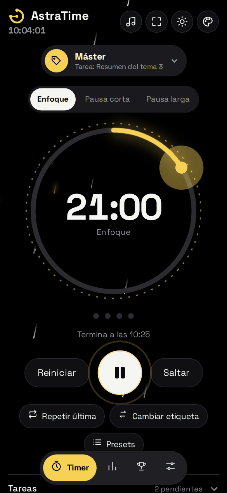
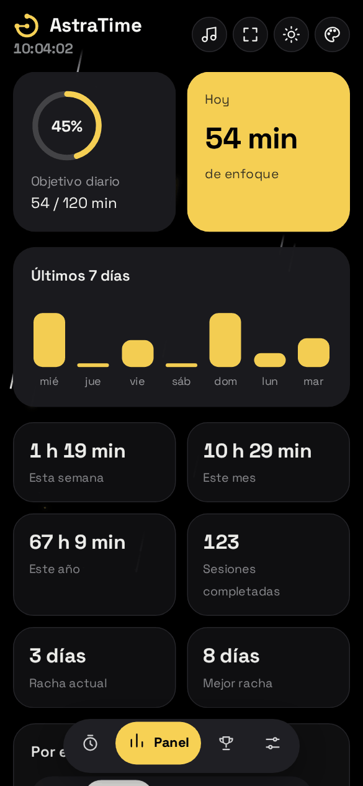
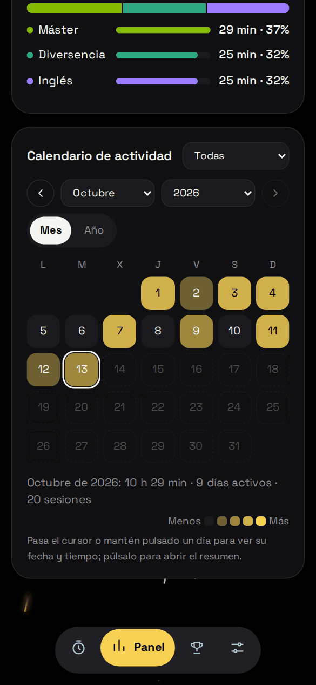
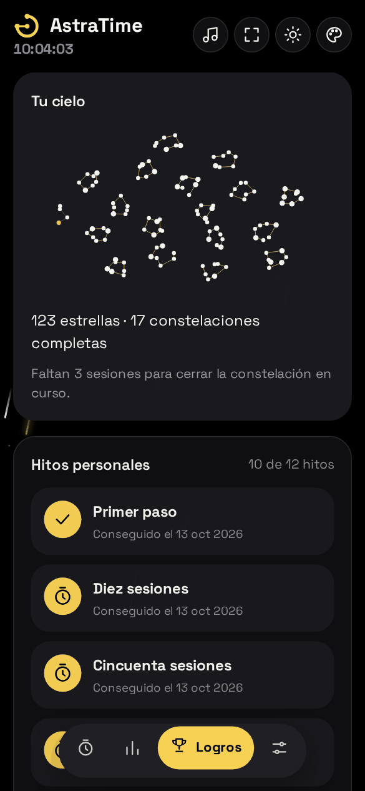

# AstraTime

**Temporizador Pomodoro con registro de horas de estudio.** Funciona en el navegador, se instala como una aplicación en el móvil y en el ordenador, no necesita cuenta y guarda tus datos en tu propio dispositivo.

<p align="center">
  
  
  
  
</p>

## Qué es y para qué sirve

La técnica Pomodoro consiste en trabajar en bloques de tiempo concentrado (por defecto, 25 minutos) separados por descansos cortos (5 minutos). Tras varios bloques (por defecto, 4) se hace un descanso largo (15 minutos).

AstraTime aplica esa técnica y, además, **registra cuánto tiempo estudias y en qué**. Cada sesión de enfoque se guarda con su hora de inicio, su duración y una etiqueta (por ejemplo, el nombre de una asignatura). Con ese registro la aplicación calcula tus totales por día, semana, mes y año, te muestra un calendario de actividad y te ayuda a planificar tus bloques de estudio.

Nació como herramienta personal para llevar un control transparente de las horas de estudio y organizarse mejor. El código es abierto, por si resulta útil a más gente.

## Empezar en un minuto

1. Abre la aplicación en el navegador (ver [Publicar tu propia copia](#publicar-tu-propia-copia)). Si quieres, instálala: en Chrome o Edge aparece un icono de instalar en la barra de direcciones; en Android, menú > *Instalar aplicación*; en iPhone, Safari > *Compartir* > *Añadir a pantalla de inicio*.
2. Pulsa el botón de **play**. El círculo se va llenando con el color del tema y suena un aviso al terminar.
3. Para registrar en qué estudias, pulsa la etiqueta de arriba y elige una (las creas en *Ajustes > Etiquetas*).
4. Entra en **Panel** para ver tus horas y en **Logros** para ver tu progreso.

Todo funciona sin conexión una vez instalada.

## Cómo se usa cada parte

La barra inferior tiene cuatro vistas: **Timer**, **Panel**, **Logros** y **Ajustes**.

### Timer

- **Fases:** *Enfoque*, *Pausa corta* y *Pausa larga*. Los puntos bajo el círculo marcan cuántos bloques llevas en el ciclo. Con *Saltar* pasas a la siguiente fase y con *Reiniciar* vuelves a empezar la actual.
- **Etiqueta:** la que elijas queda asociada a cada sesión de enfoque. Puedes cambiarla en cualquier momento; si el temporizador está en marcha, la sesión se divide en dos.
- **Tareas:** en el apartado *Tareas* anotas lo que quieres hacer, con un tiempo estimado. Al seleccionar una tarea, las sesiones se vinculan a ella y verás el tiempo real frente al estimado.
- **Planes por bloques:** con *Presets > Nuevo plan* defines una secuencia como "60 min de Matemáticas, luego 30 min de Inglés". La aplicación va cambiando de etiqueta sola y te avisa del avance. Si un bloque se queda corto, te ofrece una **sesión extra** con la misma etiqueta. Los planes se pueden guardar como *presets* y arrancar con un solo toque.
- **Cierre de sesión:** al terminar un bloque aparece una pregunta breve: si completaste la tarea y si quieres descansar, continuar o detenerte. Se puede desactivar en Ajustes.
- **Acciones rápidas:** *Repetir última* (mismo tiempo y etiqueta que la última sesión), *Cambiar etiqueta* y *Presets*.
- **Modo inmersivo:** oculta todo salvo el temporizador y la etiqueta (botón de pantalla completa de la cabecera o tecla `M`).
- **Pantalla encendida:** mientras corre el temporizador, la pantalla no se apaga (se puede desactivar).

### Panel

- **Objetivo diario**, tiempo de **hoy** y gráfico de los **últimos 7 días**.
- Totales de la semana, el mes y el año, sesiones completadas y **rachas** (días seguidos con estudio). Las rachas se pueden ocultar en Ajustes si prefieres no tener ese contador.
- **Por etiqueta:** cuánto tiempo has dedicado a cada una, por día, semana, mes, año o en total.
- **Calendario de actividad:** vista por mes o por año, con un filtro por etiqueta. Cada día se colorea según el tiempo estudiado. Pasa el cursor (o mantén pulsado en el móvil) por un día para ver su fecha y tiempo; pulsa el día para abrir su resumen. Desde ahí puedes **corregir errores**: editar la etiqueta, la duración o la fecha de una sesión, añadir una sesión manual o eliminarla. Las estadísticas se recalculan solas.

### Logros

- **Tu cielo:** cada sesión completada añade una estrella. Cada siete estrellas se cierra una constelación.
- **Hitos personales:** 12 hitos (primera sesión, 10, 50 y 100 sesiones, 10, 50 y 100 horas, 5 etiquetas distintas, constancia semanal, una sesión de 50 minutos, cumplir el objetivo diario y completar un plan). No hay comparaciones con otras personas.

### Ajustes

Duración de cada fase, objetivo diario, inicio automático de la siguiente fase, cierre de sesión, pantalla encendida, avisos del navegador, contador de rachas, **apariencia** (claro, oscuro o automático; color del tema a elegir), **accesibilidad** (reducir animaciones y alto contraste), **sonido de aviso** (6 sonidos y volumen), etiquetas, presets, atajos de teclado y copias de seguridad.

El color del tema se elige con el icono de paleta de la cabecera y se recuerda al volver a abrir la aplicación.

### Música

El icono de nota musical abre un reproductor flotante: pega el enlace de un vídeo o una lista de YouTube o YouTube Music. **Minimizarlo** mantiene la música sonando; **cerrarlo o pausarlo** la detiene. YouTube puede mostrar anuncios dentro del reproductor, y la aplicación no puede eliminarlos.

### Atajos de teclado

| Tecla | Acción |
|---|---|
| `Espacio` | Iniciar o pausar |
| `S` | Saltar fase |
| `R` | Reiniciar fase |
| `M` | Modo inmersivo (`Esc` para salir) |
| `T` | Siguiente etiqueta |
| `1`–`4` | Cambiar de vista |

## Tus datos

- **Dónde se guardan:** en tu propio dispositivo (en el almacenamiento local del navegador). No hay servidor, cuentas ni estadísticas de uso.
- **Copia de seguridad en un archivo:** *Ajustes > Copia del historial* permite **exportar** todo a un archivo e **importarlo** en otro dispositivo.
- **Copia en Google Drive (opcional):** sincroniza el historial entre dispositivos usando una carpeta oculta de tu propio Drive que solo AstraTime puede leer. Requiere crear un identificador de Google una sola vez (ver más abajo).
- **Móvil y ordenador a la vez:** al combinar dispositivos, las sesiones no se duplican, y si dos sesiones coinciden en el tiempo, ese tramo se cuenta una sola vez. Si editas la misma sesión en dos sitios, prevalece el cambio más reciente.
- **Si borras los datos del navegador**, el historial local se pierde. Exporta una copia de vez en cuando.

## Preguntas frecuentes

**¿Funciona sin internet?** Sí, una vez abierta por primera vez. Solo necesitan conexión el reproductor de YouTube y la copia en Drive.

**¿Por qué no veo las animaciones?** Si tu sistema tiene activada la reducción de movimiento, AstraTime la respeta y las desactiva. Ajustes lo indica con un aviso y explica cómo cambiarlo. También puedes desactivarlas tú con *Reducir animaciones*.

**¿Suena el aviso con la pantalla bloqueada?** Depende del navegador: los móviles pueden frenar las pestañas en segundo plano. El tiempo se calcula bien, pero el aviso puede retrasarse. Con la aplicación cerrada no hay avisos.

**¿Los sonidos tienen derechos de autor?** No: se generan en el dispositivo con la Web Audio API. La aplicación no incluye archivos de audio.

## Publicar tu propia copia

La aplicación es un sitio estático: no necesita servidor. Con GitHub Pages se publica gratis.

1. Crea un repositorio público en GitHub y sube el contenido de este proyecto (el archivo `index.html` debe quedar en la raíz).
2. En *Settings > Pages*, elige *Deploy from a branch*, la rama `main` y la carpeta `/ (root)`.
3. En uno o dos minutos estará en `https://<usuario>.github.io/<repositorio>/`.

Para probarla en local (los módulos y el service worker requieren `http://`, no basta con abrir el archivo):

```bash
python3 -m http.server 8000
# abrir http://localhost:8000
```

### Configurar la copia en Google Drive

1. Crea un proyecto en [Google Cloud Console](https://console.cloud.google.com/) y habilita **Google Drive API**.
2. Configura la *Pantalla de consentimiento de OAuth* (usuario *Externo*), añade el ámbito `https://www.googleapis.com/auth/drive.appdata` y, mientras esté en modo *Testing*, tu cuenta como usuario de prueba.
3. Crea un *ID de cliente de OAuth* de tipo *Aplicación web* con el dominio de la aplicación como origen autorizado (por ejemplo, `https://<usuario>.github.io`; no hace falta URI de redireccionamiento).
4. Pega el ID en *Ajustes > Copia de seguridad en Google Drive* y pulsa *Conectar y sincronizar*.

La conexión dura aproximadamente una hora; después basta con pulsar *Sincronizar ahora*. El identificador no es secreto, pero se guarda solo en tu navegador.

## Cómo está hecho

Aplicación web progresiva (PWA) en **HTML, CSS y JavaScript sin dependencias ni paso de compilación**. Usa módulos ES nativos.

```
index.html          Estructura y logotipo SVG
manifest.json       Datos de instalación como aplicación
sw.js               Service worker: guarda los archivos para el uso sin conexión
css/styles.css      Estilos, temas, animaciones y accesibilidad
fonts/              Tipografía Space Grotesk (licencia OFL)
icons/              Logotipo e iconos
docs/               Capturas de este README
js/
  main.js           Arranque, navegación, atajos e instalación
  data.js           Modelo de datos, guardado y fusión de copias
  stats.js          Cálculo de tiempos, rachas y totales
  timer.js          Motor del temporizador
  timer-ui.js       Representación del temporizador, título y favicon
  plans.js          Planes por bloques y presets
  tasks.js          Tareas con tiempo estimado y real
  closing.js        Cierre inteligente de sesión
  panel.js          Panel de estadísticas
  calendar.js       Calendario, resumen diario y edición
  badges.js         Hitos y cielo de estrellas
  theme.js          Tema, contraste, logotipo y favicon dinámico
  fx.js             Animaciones ambientales
  audio.js          Sonidos generados por código
  music.js          Reproductor de YouTube
  drive.js          Copia en Google Drive
  backup.js         Exportar e importar
  settings.js, dialogs.js, wake.js, bus.js, storage.js, util.js, icons.js, boot.js
```

**Modelo de datos.** Todo se guarda en `localStorage` con el prefijo `astratime.`. Cada sesión es un registro `[id, inicio, fin, etiqueta, completada, tarea, bloque, actualización, borrada]`. Los totales **no se guardan**: se calculan siempre a partir de las sesiones, por lo que editar o borrar una sesión mantiene coherentes todas las estadísticas. Para combinar dispositivos, las sesiones se identifican por `id`, el tiempo coincidente se une en intervalos (se cuenta una sola vez), prevalece la edición más reciente y los borrados se propagan mediante marcas de borrado y una época de borrado total. Esto presupone que los relojes de los dispositivos están razonablemente sincronizados.

**Tiempo.** El temporizador calcula el tiempo restante a partir de una hora de finalización absoluta, de modo que ralentizar la pestaña en segundo plano no genera deriva.

**Sin conexión.** El service worker guarda todos los archivos propios (estrategia *cache-first*). Al cambiar cualquier archivo conviene subir la versión de `CACHE` en `sw.js` para que los dispositivos actualicen. Las peticiones a otros orígenes (Google, YouTube) no se interceptan.

**Accesibilidad.** Navegación por teclado, diálogos nativos `<dialog>`, etiquetas ARIA, anuncios para lectores de pantalla, modo de alto contraste y reducción de animaciones (conmutador propio y preferencia `prefers-reduced-motion` del sistema). Las animaciones están activas por defecto en cualquier tamaño de pantalla; solo esos dos controles las desactivan.

**Recursos de terceros.** Tipografía Space Grotesk autoalojada (licencia SIL OFL 1.1, en `fonts/OFL-Space-Grotesk.txt`). Los logotipos e iconos son propios. Google Identity Services y la API de Drive solo se cargan al conectar Drive, y el contenido de YouTube solo al abrir el reproductor.

**Limitaciones.** Los navegadores pueden frenar las pestañas en segundo plano. Algunos vídeos de YouTube no permiten la reproducción incrustada. El permiso de acceso a Drive caduca en torno a una hora. Las etiquetas eliminadas en un dispositivo no se eliminan en los demás.

## Cómo se ha desarrollado

La idea, los requisitos y la dirección del proyecto son de la autora. El código ha sido generado con la asistencia de inteligencia artificial (Claude, de Anthropic), a partir de especificaciones y revisiones iterativas definidas por la autora.

Se verificó con pruebas automatizadas de extremo a extremo en Chromium sin interfaz (temporizador, planes, tareas, calendario y edición, sincronización simulada con Drive, reproductor simulado, modo sin conexión y accesibilidad), que no se incluyen en el repositorio. Como cualquier software de uso personal, se ofrece sin garantías: conviene revisar el código antes de confiarle datos que no puedas reponer.

## Licencia

Este proyecto se publica bajo la **licencia MIT** (archivo [`LICENSE`](LICENSE)). En palabras sencillas: cualquier persona puede usar, copiar, modificar y compartir el código, también en proyectos propios o comerciales, siempre que conserve el aviso de copyright y la licencia. El software se ofrece "tal cual", sin garantía de ningún tipo.

La tipografía Space Grotesk conserva su propia licencia (SIL Open Font License 1.1), incluida en `fonts/`.
